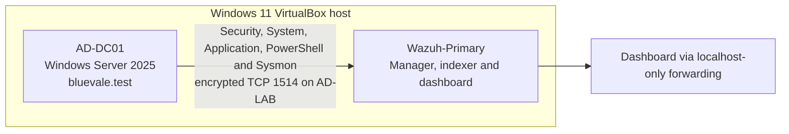
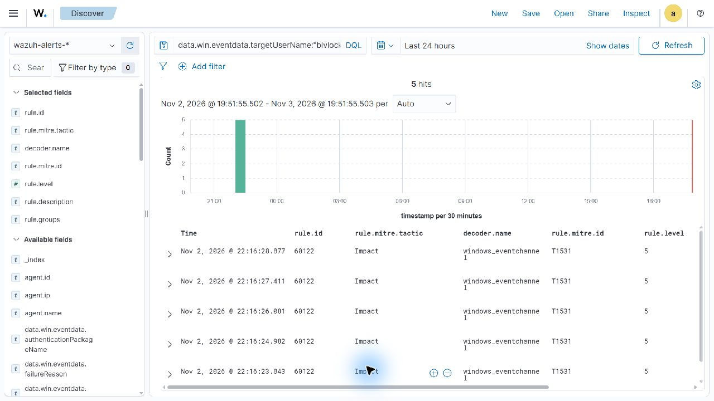
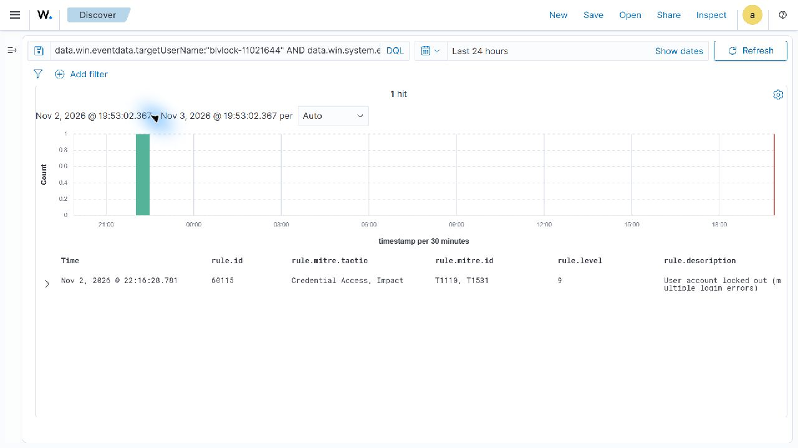
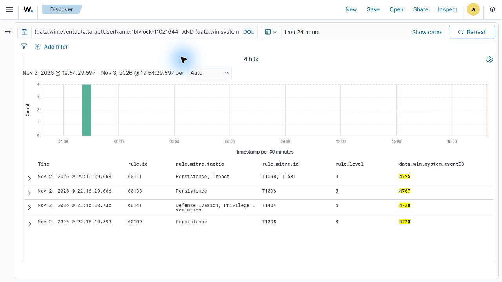

# Active Directory Threat Detection and Incident Response Lab

> **v1.0:** A completed, resource-aware identity detection lab with an isolated Windows Server domain controller, Wazuh and Sysmon telemetry, two detection objectives, one end-to-end investigation, and live evidence for ten scenario events.

## Overview

This project extends the [Home SOC Lab](https://github.com/Abdullahchoglay/home-soc-lab) and [Sysmon Threat Detection Lab](https://github.com/Abdullahchoglay/sysmon-detection-lab) into Active Directory monitoring. It focuses on evidence-backed identity detection rather than repeating the earlier Wazuh installation and endpoint-telemetry work.

The lab demonstrates:

- An isolated fictional `bluevale.test` forest on Windows Server 2025
- Windows Security, PowerShell and Sysmon collection through Wazuh `4.14.7`
- Five controlled failed network logons followed by an account lockout
- Live Wazuh alert mapping for account creation, group membership, unlock and disable actions
- ATT&CK-aware analysis that distinguishes observed rule metadata from analyst interpretation
- Sanitized evidence, reproducible safety gates and explicit limitations

## Architecture



`AD-LAB` is a VirtualBox internal network. The domain controller has no connected NAT or bridged path during identity testing. No LDAP, Kerberos, DNS, SMB, RPC or RDP service is publicly exposed. A separate client VM was excluded from v1.0 because measured host memory made a third simultaneous VM unsafe; see [known limitations](docs/known-limitations.md).

## Verified scenario

Marker `BLV-AUTH-20261102-164444` identified one bounded fictional-account sequence:

| Activity | Windows event | Count | Live Wazuh result |
|---|---:|---:|---|
| Failed network logon | `4625` | `5` | Rule `60122`, level `5` |
| Account created | `4720` | `1` | Rule `60109`, level `8` |
| Added to unprivileged group | `4728` | `1` | Rule `60141`, level `5` |
| Account locked out | `4740` | `1` | Rule `60115`, level `9` |
| Account unlocked | `4767` | `1` | Rule `60133`, level `5` |
| Account disabled | `4725` | `1` | Rule `60111`, level `8` |

The exact account filter returned 18 live alerts. The five `4625` records exposed network logon type `3`, `Negotiate`, the bad-password status/substatus pair and the controlled PowerShell process. Event ID `4728` required the added principal to be queried in `memberName`, while `targetUserName` represented the group.

The account password was generated only in memory, never printed or committed, and the account finished disabled. The group was the unprivileged `GG-Employees`; no privileged-group test is claimed.

## Detection engineering

- [`AD-LOCKOUT-001`](detections/AD-LOCKOUT-001.md) — five failed logons followed by a high-confidence lockout
- [`AD-ACCOUNT-LIFECYCLE-001`](detections/AD-ACCOUNT-LIFECYCLE-001.md) — account and group changes with field-aware triage guidance

No custom Wazuh rules were deployed. Built-in rules already produced reliable, useful alerts; duplicating them would add maintenance without analytical value. Future custom logic is reserved for multi-event correlation, source enrichment or privileged-group prioritization.

## Investigation and evidence

- [`IR-001`](investigations/IR-001-controlled-account-lockout.md) — executive summary, timeline, evidence, interpretation, cleanup and limitations
- [`WAZ-002`](evidence/WAZ-002-controlled-lockout-indexing.md) — exact live lockout mapping
- [`WAZ-003`](evidence/WAZ-003-account-lifecycle-indexing.md) — exact live lifecycle mappings
- [`WAZ-004`](evidence/WAZ-004-failed-logon-indexing.md) — five live failure alerts and expanded authentication fields
- [Evidence index](evidence/README.md) — migration, domain, audit, Wazuh, Sysmon and scenario evidence

Local Windows evidence, encrypted transport evidence and live Wazuh alerts are identified separately. Raw EVTX, packet captures, unrestricted JSON, exact private addresses, SIDs and credentials remain outside Git.

### Sanitized Wazuh evidence

| Five failed logons | Account lockout | Account lifecycle |
|---|---|---|
|  |  |  |

These full-screen, column-restricted captures exclude browser chrome, private address values, SIDs, credentials and unrestricted event payloads.

## Configuration and reproduction

- [Configuration and integration reference](docs/configuration-reference.md)
- [Architecture and network boundaries](docs/architecture.md)
- [Safe reproduction guide](docs/reproduction-guide.md)
- [`Invoke-ControlledLockoutLab.ps1`](scripts/Invoke-ControlledLockoutLab.ps1) — bounded, domain-gated reproduction helper
- [Troubleshooting record](docs/troubleshooting.md)
- [Cleanup and shutdown procedure](docs/cleanup-and-shutdown.md)
- [Project completion report](docs/project-completion-report.md)

The Sysmon profile is reused by hash from the earlier project and attributed to Olaf Hartong's Sysmon Modular project and contributors rather than duplicated here.

## Safety boundaries

- Systems, VMs, accounts and networks owned by the project author only
- Fictional identities and non-production credentials only
- No credential dumping, malware, public AD exposure or destructive payloads
- Configuration validation and recoverable snapshots before material changes
- Reviewed screenshots and text-first sanitized evidence

See [scope and safety](docs/scope-and-safety.md) and [known limitations](docs/known-limitations.md).

## Repository map

```text
detections/       Detection objectives, verified rules and triage guidance
docs/             Architecture, configuration, reproduction, safety and operations
evidence/         Sanitized evidence summaries and classification
investigations/   Incident-analysis report
rules/            Documented custom-rule decision
scripts/          Bounded reproduction helper
screenshots/      Reviewed screenshots only
```

## Release validation

The v1.0 release gate includes current-tree and full-history privacy scanning, PowerShell syntax validation, Markdown link checking, screenshot review, claim review, Git integrity checks and local/remote parity. Results are recorded in [release validation](docs/release-validation.md).

The [publication record](docs/publication-record.md) documents the completed public-release checks, repository metadata and LinkedIn launch. The final announcement text and live post link are preserved in the [LinkedIn announcement record](docs/linkedin-post.md).
