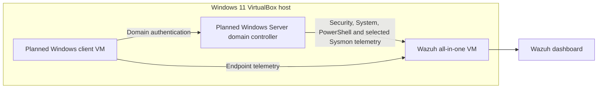

# Active Directory Threat Detection and Incident Response Lab

> **Status: Infrastructure migration verified; Windows Server installation at credential handoff.** This private repository remains a working draft. No Active Directory detection result, alert, or investigation outcome is claimed until supported by reviewed evidence.

## Overview

This project will extend the existing [Home SOC Lab](https://github.com/Abdullahchoglay/home-soc-lab) and [Sysmon Detection Lab](https://github.com/Abdullahchoglay/sysmon-detection-lab) with identity-focused monitoring in an isolated Active Directory environment.

The planned lab will connect Windows domain telemetry to Wazuh, develop defensible detections, and document harmless controlled scenarios using local evidence, rule validation, and live alerts where available.

## Planned architecture



The lab network will be isolated from the public internet. Active Directory services will not be exposed through bridged networking or public port forwarding.

## Objectives

- Build a small test-only Active Directory forest.
- Monitor the domain controller with Wazuh.
- Collect identity, Kerberos, account-management, PowerShell, task, service, and selected Sysmon telemetry.
- Develop focused custom Wazuh rules only where built-in coverage is insufficient.
- Investigate controlled activity using unique markers and exact timestamps.
- Map verified activity to appropriate MITRE ATT&CK techniques.
- Publish only sanitized evidence that supports each claim.

## Planned scenarios

| Area | Examples | Status |
|---|---|---|
| Authentication | Successful and failed domain logons | Planned |
| Authentication abuse | Bounded failures against test accounts | Planned |
| Account lifecycle | Create, disable, enable and delete test users | Planned |
| Access control | Add and remove a test user from a privileged group | Planned |
| Lockout | Trigger and investigate a test-account lockout | Planned |
| Kerberos | TGT and service-ticket activity | Planned |
| Directory changes | Selected Group Policy or directory-object changes | Planned |
| Endpoint activity | Marked PowerShell, scheduled task and service creation | Planned |
| Process telemetry | Parent-child relationships, command lines and hashes | Planned |

## Evidence standard

Every completed scenario must record:

- A unique test marker
- Exact timestamp and timezone
- Host and test-account context
- Local Windows or Sysmon evidence
- Wazuh ingestion or independent rule-test evidence
- Event IDs, rule IDs, levels and relevant decoded fields
- MITRE ATT&CK mapping
- Analyst conclusion and limitations

Local evidence, synthetic rule testing, and live Wazuh alerts will always be identified separately.

## Safety boundaries

- Systems and accounts owned by the project author only
- Test identities and non-production passwords only
- No credential dumping, malware, destructive actions or uncontrolled exploit code
- No exposure of AD services to the public internet
- Configuration backups before changes
- Syntax validation before service restarts
- Service-health checks after material changes
- No credentials, private keys, personal identifiers or unsafe raw logs committed

See [scope and safety](docs/scope-and-safety.md) for the full working boundary.

## Verified infrastructure state

The Wazuh VM migration to the destination laptop was validated on 1 November 2026. The powered-off transferred disk received a SHA-256 baseline, a separate permanent clone was created, and the original transfer copy was retained as recovery media. The clone booted successfully; Wazuh agent and enrollment listeners were reachable, the dashboard redirected to its login page, and the API returned the expected unauthenticated `401` response.

The permanent clone uses Wazuh `4.14.7`, a 64 GB dynamic disk, 6 GB RAM, localhost-only management forwarding, and a second adapter on the VM-only `AD-LAB` internal network. Guest package consistency and filesystem expansion remain pending authenticated guest validation. See [migration validation](evidence/MIG-001-migration-validation.md).

`AD-DC01` has booted the verified Windows Server 2025 Standard Evaluation (Desktop Experience) media and completed installation to its dedicated 64 GB virtual disk. Setup is paused at the built-in Administrator password handoff; no password is stored in this repository. The VM currently uses 3 GB RAM and one vCPU because two vCPUs caused a reproducible EFI `DXE_AP` stall under the host's Windows-hypervisor-backed VirtualBox path. The second vCPU will be re-tested after first-run setup. The installer ISO has been ejected, the `AD-LAB` adapter remains isolated, and the secondary NAT adapter remains temporary. No Active Directory role or telemetry result is claimed.

## Roadmap

1. [x] Verify destination resources and virtualization support.
2. [x] Preserve, clone and validate the migrated Wazuh VM.
3. [x] Create the VirtualBox `AD-LAB` internal network attachment on Wazuh.
4. [x] Prepare the powered-off domain-controller VM hardware and isolated adapters.
5. [x] Acquire and verify supported Windows evaluation media from Microsoft.
6. [ ] Finish first-run setup, install updates and harden the domain controller.
7. [ ] Add a separate Windows domain client if the resource test passes.
8. [ ] Configure auditing, Wazuh and selected Sysmon telemetry.
9. [ ] Baseline normal domain activity and execute harmless marked scenarios.
10. [ ] Develop detections and produce investigation reports.
11. [ ] Complete secret, evidence, syntax and publication review.

## Repository structure

```text
docs/             Architecture, build notes, safety, evidence standards and troubleshooting
detections/       Detection objectives, logic and analyst guidance
rules/            Custom Wazuh rules and validation notes
investigations/   Scenario reports and analyst conclusions
evidence/         Sanitized evidence summaries and index
scripts/          Harmless reproduction and validation helpers
screenshots/      Reviewed screenshots only
```

## Relationship to previous work

This project will not repeat the existing Wazuh installation, endpoint enrollment, FIM, local failed-logon, PowerShell 4104, or baseline Sysmon work already documented in the first two projects. It will reuse that foundation and concentrate on Active Directory identity telemetry and incident-response analysis.

## Publication status

This repository remains private while the infrastructure and evidence are incomplete. A public release and version tag will be considered only after syntax checks, secret scanning, evidence review, link validation and claim verification.
