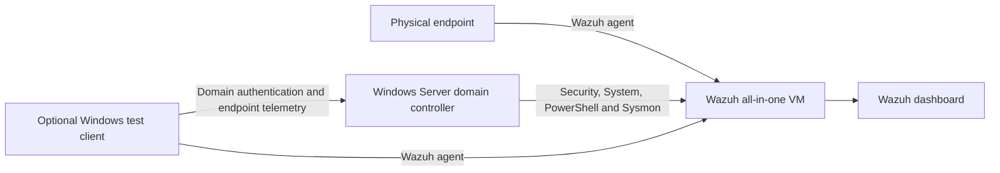

# Active Directory Threat Detection and Incident Response Lab

> **Status: Planning and infrastructure preparation.** This private repository is a working draft. No Active Directory deployment, detection result, alert, or investigation outcome is claimed until supported by reviewed evidence.

## Overview

This project will extend the existing [Home SOC Lab](https://github.com/Abdullahchoglay/home-soc-lab) and [Sysmon Detection Lab](https://github.com/Abdullahchoglay/sysmon-detection-lab) with identity-focused monitoring in an isolated Active Directory environment.

The planned lab will connect Windows domain telemetry to Wazuh, develop defensible detections, and document harmless controlled scenarios using local evidence, rule validation, and live alerts where available.

## Planned architecture



The lab network will be isolated from the public internet. Active Directory services will not be exposed through bridged networking or public port forwarding.

## Objectives

- Build a small test-only Active Directory forest.
- Monitor the domain controller with Wazuh.
- Collect identity, Kerberos, account-management, PowerShell, task, service, and selected Sysmon telemetry.
- Develop focused custom Wazuh rules only where built-in coverage is insufficient.
- Investigate controlled activity using unique markers and exact timestamps.
- Map verified activity to appropriate MITRE ATT&CK techniques.
- Publish only sanitized evidence that supports each claim.

## Planned scenarios

| Area | Examples | Status |
|---|---|---|
| Authentication | Successful and failed domain logons | Planned |
| Authentication abuse | Bounded failures against test accounts | Planned |
| Account lifecycle | Create, disable, enable and delete test users | Planned |
| Access control | Add and remove a test user from a privileged group | Planned |
| Lockout | Trigger and investigate a test-account lockout | Planned |
| Kerberos | TGT and service-ticket activity | Planned |
| Directory changes | Selected Group Policy or directory-object changes | Planned |
| Endpoint activity | Marked PowerShell, scheduled task and service creation | Planned |
| Process telemetry | Parent-child relationships, command lines and hashes | Planned |

## Evidence standard

Every completed scenario must record:

- A unique test marker
- Exact timestamp and timezone
- Host and test-account context
- Local Windows or Sysmon evidence
- Wazuh ingestion or independent rule-test evidence
- Event IDs, rule IDs, levels and relevant decoded fields
- MITRE ATT&CK mapping
- Analyst conclusion and limitations

Local evidence, synthetic rule testing, and live Wazuh alerts will always be identified separately.

## Safety boundaries

- Systems and accounts owned by the project author only
- Test identities and non-production passwords only
- No credential dumping, malware, destructive actions or uncontrolled exploit code
- No exposure of AD services to the public internet
- Configuration backups before changes
- Syntax validation before service restarts
- Service-health checks after material changes
- No credentials, private keys, personal identifiers or unsafe raw logs committed

See [scope and safety](docs/scope-and-safety.md) for the full working boundary.

## Current constraints

The original host lacks enough free storage for a safe two-VM deployment. The preferred design is to move the existing Wazuh VM to a higher-capacity laptop, validate the migration, and build the domain controller there. The original Windows 11 Home endpoint cannot join an on-premises domain and will remain a monitored standalone endpoint.

## Roadmap

1. Verify the destination laptop's resources and virtualization support.
2. Migrate and validate the existing Wazuh VM.
3. Establish an isolated lab network.
4. Build and harden the domain controller.
5. Configure auditing, Wazuh and selected Sysmon telemetry.
6. Baseline normal domain activity.
7. Execute harmless marked scenarios.
8. Develop and validate detections.
9. Produce investigation reports and a sanitized evidence index.
10. Complete repository review before publication.

## Repository structure

```text
docs/             Architecture, build notes, safety, evidence standards and troubleshooting
detections/       Detection objectives, logic and analyst guidance
rules/            Custom Wazuh rules and validation notes
investigations/   Scenario reports and analyst conclusions
evidence/         Sanitized evidence summaries and index
scripts/          Harmless reproduction and validation helpers
screenshots/      Reviewed screenshots only
```

## Relationship to previous work

This project will not repeat the existing Wazuh installation, endpoint enrollment, FIM, local failed-logon, PowerShell 4104, or baseline Sysmon work already documented in the first two projects. It will reuse that foundation and concentrate on Active Directory identity telemetry and incident-response analysis.

## Publication status

This repository remains private while the infrastructure and evidence are incomplete. A public release and version tag will be considered only after syntax checks, secret scanning, evidence review, link validation and claim verification.
