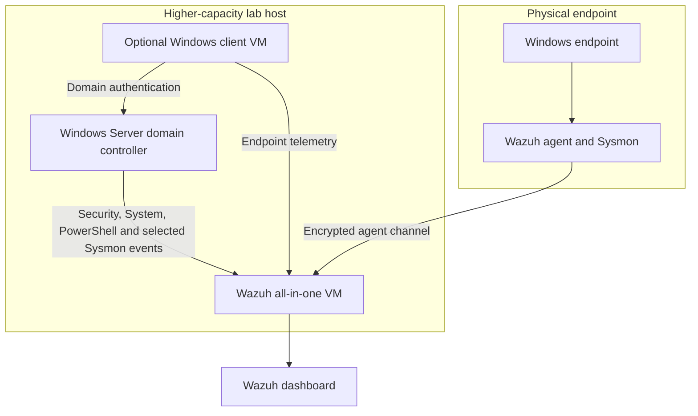

# Planned Architecture

## Logical design

## Network boundaries

- The Wazuh, domain-controller and optional client systems use a dedicated private lab network.
- No AD service is exposed through public port forwarding.
- Bridged access to the normal home network is avoided.
- Internet access, if temporarily required for installation or updates, is removed or constrained before testing.
- Only required Wazuh enrollment and agent traffic crosses between the physical endpoint and lab host.

Exact addresses, adapter identifiers and machine identifiers will remain outside the public documentation.

## Resource assumptions

The destination host should provide enough storage for the existing Wazuh VM, a Windows Server VM, working evidence and recovery points. Wazuh and the domain controller should be validated independently before simultaneous operation.
