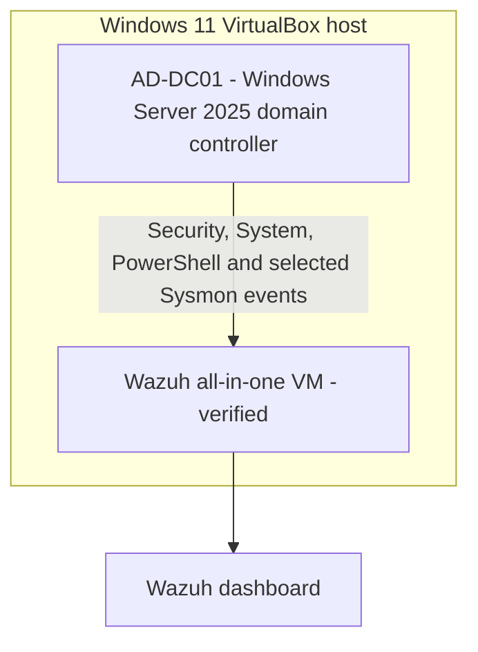
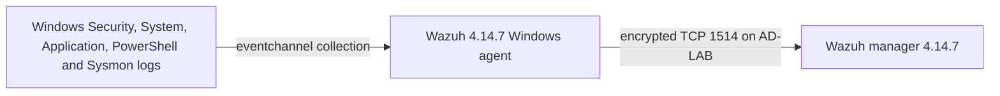

# Lab Architecture

## Logical design

This two-VM design is the completed v1.0 scope. A separate Windows client was excluded after the final resource check found only about 1.4 GB host memory free with Wazuh and the domain controller running.

## Network boundaries

- Wazuh is attached to a dedicated VirtualBox internal network named `AD-LAB`.
- The domain controller uses the same VM-only network as Wazuh.
- No AD service is exposed through public port forwarding.
- Bridged access to the normal home network is avoided.
- Wazuh retains a NAT adapter for constrained outbound access. Dashboard, API, SSH, agent and enrollment forwards bind only to host loopback.
- Windows installation and update access used temporary NAT. The guest adapter and its VirtualBox link are now disabled before identity testing.

Exact addresses, adapter identifiers and machine identifiers will remain outside the public documentation.

## Resource assumptions

The host has approximately 16 GB RAM. Wazuh uses 4.5 GB and 2 vCPU. The domain controller uses 3 GB and one vCPU; two-vCPU boot tests consistently stalled in EFI under the current VirtualBox/Windows-hypervisor path. Simultaneous operation left a narrow but usable margin. A separate client is intentionally outside v1.0 and should be attempted only after increasing available memory or running fewer VMs concurrently.

## Verified telemetry path

Local event generation, bidirectional agent transport and scenario-specific dashboard correlation are verified. Exact live alert mappings are recorded in [`WAZ-002`](../evidence/WAZ-002-controlled-lockout-indexing.md), [`WAZ-003`](../evidence/WAZ-003-account-lifecycle-indexing.md) and [`WAZ-004`](../evidence/WAZ-004-failed-logon-indexing.md).
