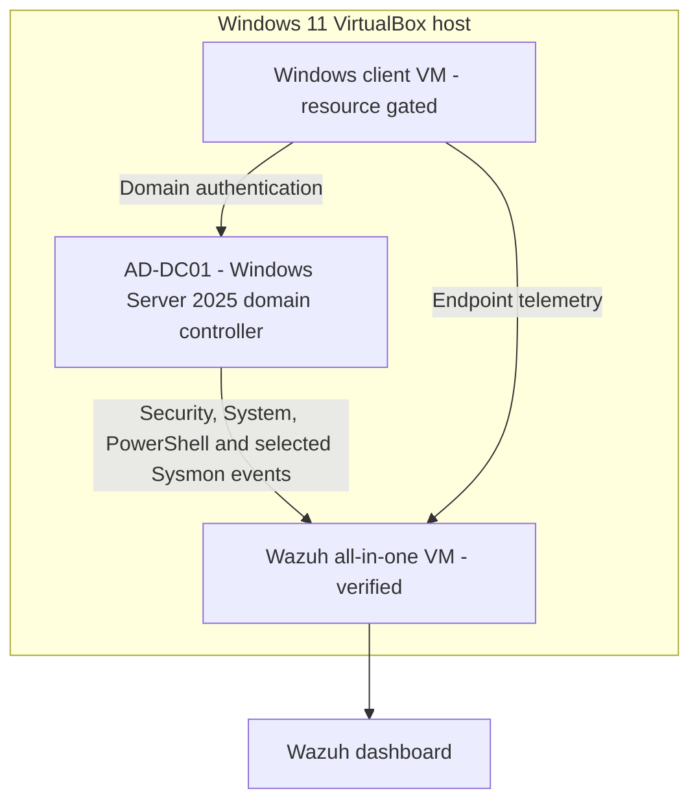
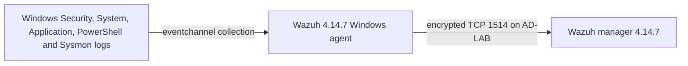

# Lab Architecture

## Logical design

## Network boundaries

- Wazuh is attached to a dedicated VirtualBox internal network named `AD-LAB`.
- The domain controller and client will join the same VM-only network.
- No AD service is exposed through public port forwarding.
- Bridged access to the normal home network is avoided.
- Wazuh retains a NAT adapter for constrained outbound access. Dashboard, API, SSH, agent and enrollment forwards bind only to host loopback.
- Windows installation and update access used temporary NAT. The guest adapter and its VirtualBox link are now disabled before identity testing.

Exact addresses, adapter identifiers and machine identifiers will remain outside the public documentation.

## Resource assumptions

The host has approximately 16 GB RAM. Wazuh uses 4.5 GB and 2 vCPU. The domain controller uses 3 GB and one vCPU; two-vCPU boot tests consistently stalled in EFI under the current VirtualBox/Windows-hypervisor path. Simultaneous operation left a narrow but usable host-memory margin. A separate Windows client remains resource gated and should be attempted only after shutting down unrelated workloads or revising allocations.

## Verified telemetry path

Local event generation and bidirectional agent transport are verified. Dashboard indexing and alert correlation remain scenario-level evidence gates.
