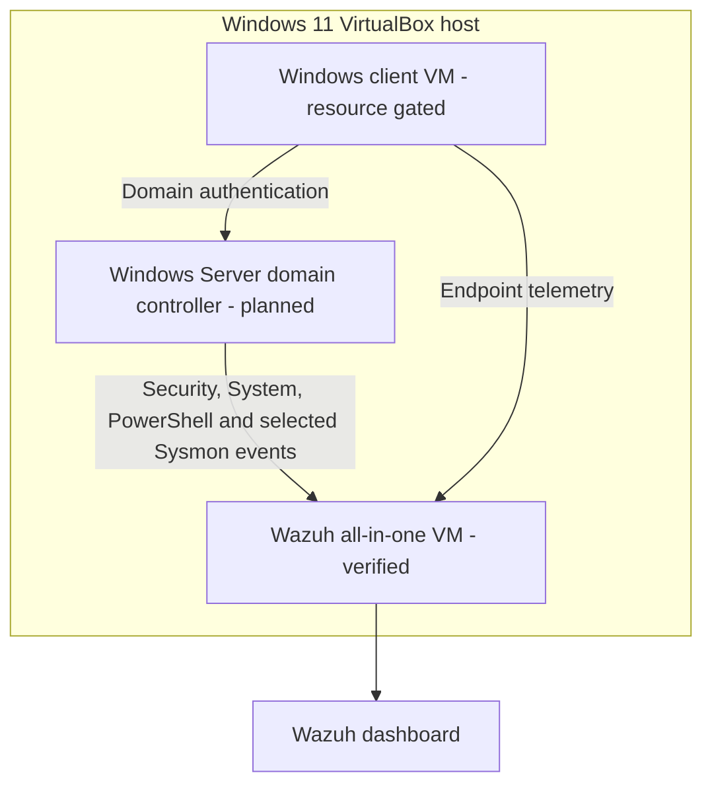

# Lab Architecture

## Logical design

## Network boundaries

- Wazuh is attached to a dedicated VirtualBox internal network named `AD-LAB`.
- The domain controller and client will join the same VM-only network.
- No AD service is exposed through public port forwarding.
- Bridged access to the normal home network is avoided.
- Wazuh retains a NAT adapter for constrained outbound access. Dashboard, API, SSH, agent and enrollment forwards bind only to host loopback.
- Windows installation and update access will use temporary NAT that is removed before identity testing.

Exact addresses, adapter identifiers and machine identifiers will remain outside the public documentation.

## Resource assumptions

The host has approximately 16 GB RAM. Wazuh uses 6 GB and 2 vCPU. The planned domain controller will use approximately 2.5–3 GB and 2 vCPU. A 4 GB Windows client is created only if the three-VM resource test leaves sufficient host memory. Unrelated memory-heavy applications must be closed during multi-VM testing.
