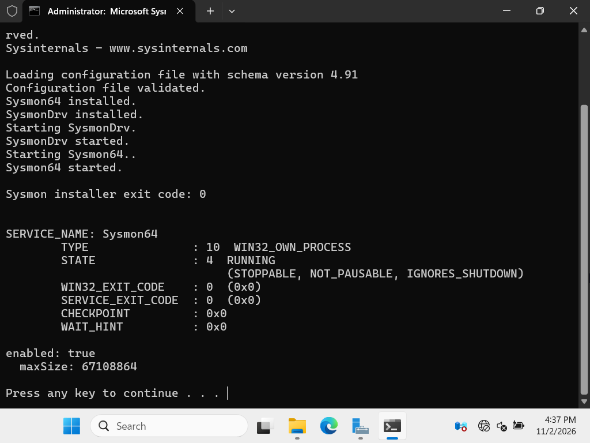
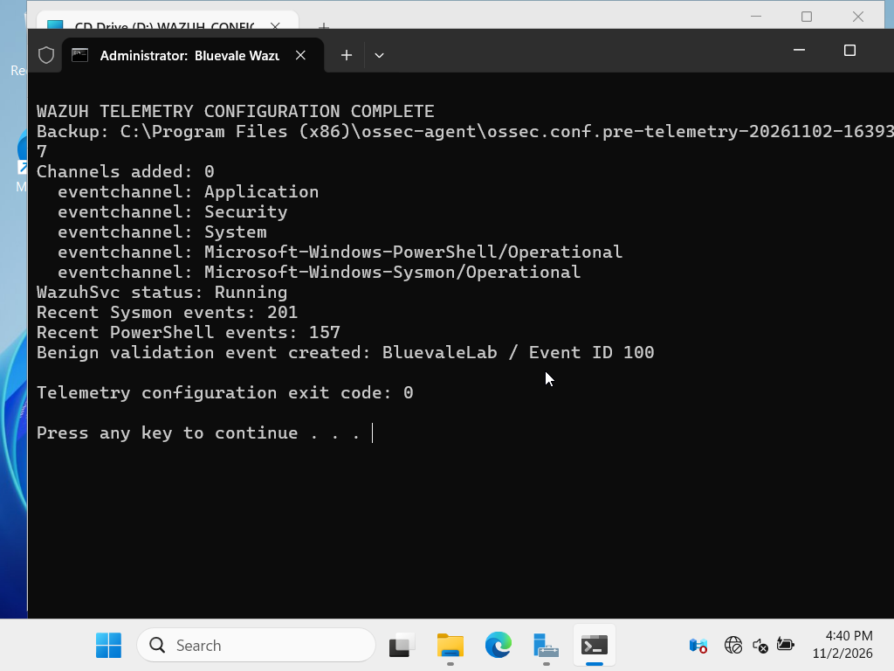

# SYS-001 — Sysmon and Wazuh telemetry baseline

## Summary

On 2 November 2026, Microsoft Sysmon `15.22` was installed on the domain controller with a reviewed XML configuration. The Sysmon service and Operational event channel were verified locally, Wazuh event-channel collection was validated, and a benign marked event was generated.

## Sysmon package validation

| Item | Verified value |
|---|---|
| Binary | `Sysmon64.exe` |
| Version | `15.22` |
| SHA-256 | `83D31F2478DC6716CFDBF69E5C384BF043072B5F0D8D7B2EEA365F709FDA4352` |
| Authenticode | Valid |
| Signer | Microsoft Windows Publisher |

The source archive was downloaded from Microsoft's official Sysinternals endpoint. Its local SHA-256 was `00ECF1B46AEC99299D3AE0BCA79DC621458BD014B20B509D7C5C8E8C8611AA54`.

The deployed XML is byte-for-byte identical to the pinned balanced Sysmon Modular profile used in the earlier [Sysmon Threat Detection Lab](https://github.com/Abdullahchoglay/sysmon-detection-lab). It is attributed to Olaf Hartong and contributors, inspired by SwiftOnSecurity's original configuration; no authorship is claimed. The exact upstream release and licensing caveat are documented in the [configuration reference](../docs/configuration-reference.md).

## Configuration validation

| Item | Verified value |
|---|---|
| XML schema version | `4.91` |
| Configuration size | 364,505 bytes |
| Configuration SHA-256 | `9EB6306AD0FEA3955E7E2148BDC7F6E0922FCA4C2A3396067C3E16A7F6CFCB44` |
| XML parse result | Well formed |
| Rule groups | 30 |

Sysmon reported that the configuration file loaded, validated and installed successfully. `Sysmon64` then reported `STATE: 4 RUNNING`, and `Microsoft-Windows-Sysmon/Operational` was enabled with a 64 MB maximum size.

## Wazuh event channels

The final idempotent configuration check found these channels present with `eventchannel` format:

- Application
- Security
- System
- Microsoft-Windows-PowerShell/Operational
- Microsoft-Windows-Sysmon/Operational

`WazuhSvc` remained running after configuration validation. The verification window counted `201` recent Sysmon events and `157` recent PowerShell Operational events. It also created the harmless marker `BluevaleLab / Event ID 100` in the Application log.

## Transport validation

A fresh 30-second capture on the isolated domain-controller adapter recorded:

- 487 total packets
- 427 packets in the bidirectional Wazuh TCP `1514` flow
- 121,630 bytes of TCP payload on that flow
- Local capture size: 158,804 bytes
- Local capture SHA-256: `89F1F9FB6CE1E961CFE16C73696AD2DA3D3B0B96CDC83B6D343CF40E56C74515`

The raw capture and exact RFC1918 addresses remain outside Git.

## Evidence classification and limitation

- Sysmon service, configuration and event channel: locally verified
- Wazuh agent configuration and service health: locally verified
- Event generation: locally verified
- Endpoint-to-manager encrypted transport after event generation: locally verified
- Dashboard mapping for this benign baseline marker: not claimed in this evidence item

This item proves the endpoint telemetry and transport foundation. The later `IR-001` identity scenario established end-to-end indexed detection for the Security events in scope; it does not retroactively claim a dashboard result for the benign baseline marker.

