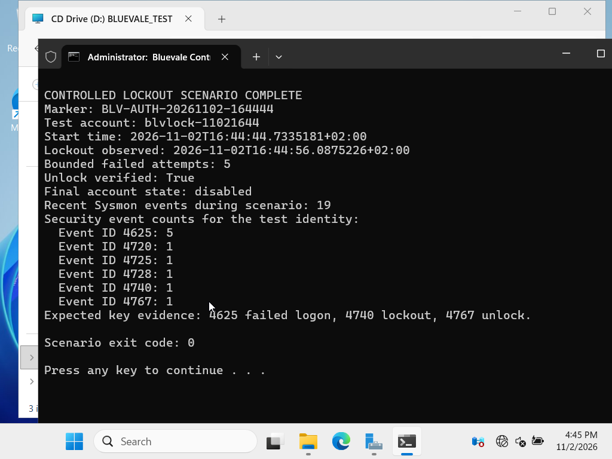

# IR-001 — Controlled account lockout

## Executive summary

A bounded password-guessing simulation was executed against one fictional lab account on 2 November 2026. Exactly five invalid network-logon attempts triggered the configured domain lockout threshold. The account was then unlocked, verified, and disabled. Local Windows evidence and post-event Wazuh transport were confirmed; dashboard indexing and Wazuh alert fields were not available for this checkpoint and are not claimed.

## Scenario identity

- Marker: `BLV-AUTH-20261102-164444`
- Test account: `blvlock-11021644`
- Domain: fictional `bluevale.test` lab only
- Attempt limit: five invalid passwords
- Final state: disabled
- Script exit code: `0`

The account password was generated at runtime, never printed or written to the repository, and cleared from script variables after account creation.

## Timeline

The guest originally recorded:

| Guest timestamp | Activity |
|---|---|
| `2026-11-02T16:44:44.7335181+02:00` | Scenario and account creation began |
| `2026-11-02T16:44:46.0875226+02:00` | Lockout observed after five bounded failures |
| Immediately afterward | Account unlocked, unlock state verified, then account disabled |

### Clock-quality caveat

The domain controller had resumed from saved state without VirtualBox Guest Additions and its clock was approximately 5 hours 32 minutes behind the host. The timestamp offset was discovered immediately after the scenario. A controlled outbound-only Windows Time synchronization corrected the guest from `16:48` to `22:20` local time using `time.windows.com`; the temporary NAT adapter and its VirtualBox cable were then disabled again.

The original guest timestamps are retained here rather than rewritten. Future scenario timestamps use the corrected clock.

## Local Windows evidence

The scenario reported these events for the test identity:

| Event ID | Count | Meaning in this scenario |
|---:|---:|---|
| 4625 | 5 | Failed logon attempts |
| 4720 | 1 | Test user created |
| 4728 | 1 | Test user added to the unprivileged employees group |
| 4740 | 1 | Test account locked out |
| 4767 | 1 | Test account unlocked |
| 4725 | 1 | Test account disabled during cleanup |

The script also counted 19 Sysmon events generated during the scenario window.

## Wazuh transport evidence

A 30-second capture on the isolated domain-controller adapter after the scenario recorded:

- 1,007 total packets
- 947 packets in the bidirectional Wazuh TCP `1514` flow
- 341,186 bytes of TCP payload on that flow
- Local raw capture size: 416,194 bytes
- Local capture SHA-256: `E9E051397E0CDE55C744C853DF692CF617E99ED5B99CBC8D65FE19436657C1C1`

The packet capture and exact RFC1918 addresses remain outside Git.

## Detection interpretation

Five failed logons for one account followed by Event ID `4740` is consistent with a bounded password-guessing pattern. MITRE ATT&CK maps systematic password attempts against an account to [T1110.001 Password Guessing](https://attack.mitre.org/techniques/T1110/001/).

This activity was authorized and generated by the lab script. It does not indicate a real compromise.

## Analyst assessment

- The domain lockout control operated at the configured threshold.
- Security auditing captured the authentication and account-lifecycle sequence.
- Sysmon continued generating endpoint telemetry during the scenario.
- Wazuh transport carried a substantial encrypted payload burst after event generation.
- The account was left disabled, limiting any residual access risk.

## Limitation and next step

The local evidence and agent transport are verified, but no dashboard event, decoder field, Wazuh rule ID or alert level is claimed. The next evidence gate is a dashboard search for the unique marker or test account after user-authenticated dashboard access.

